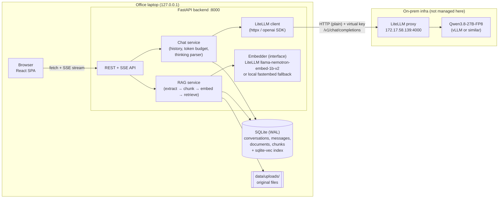
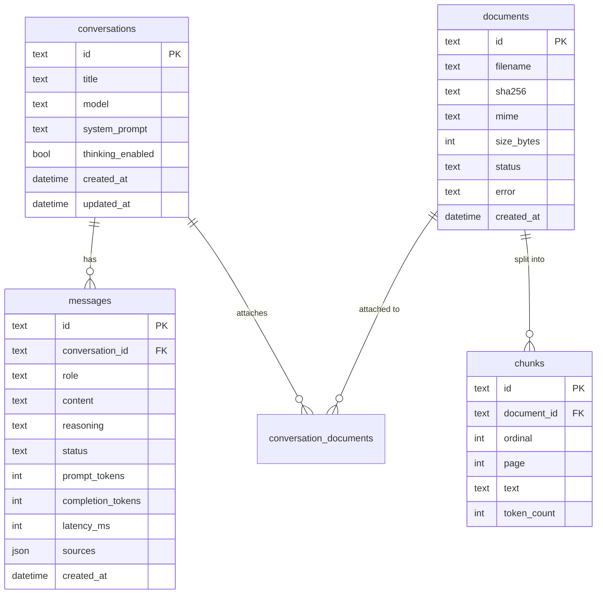
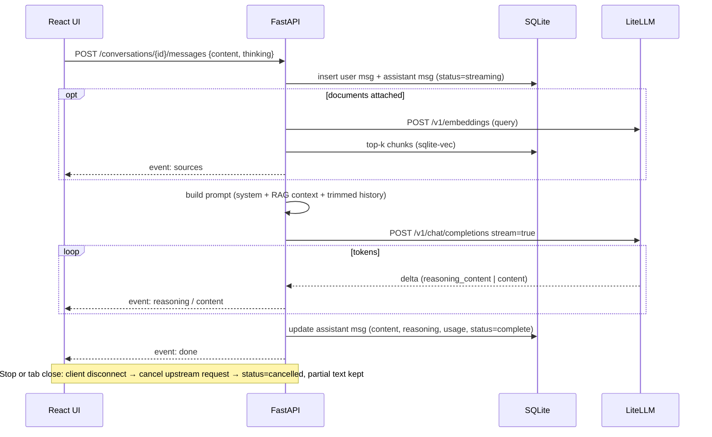

# Architecture — litellm-local-chatbot

> Status: **Draft for review** · Scope: single user, office laptop (Windows, no admin rights) · Upstream: on-prem LiteLLM at `http://172.17.58.139:4000/v1` serving model id `qwen3.8` (Qwen3.8-27B-FP8)

## 1. Goals and non-goals

**Goals**
- A ChatGPT/Claude-style web chat for one user, running locally on the office laptop.
- Talk to the **already-hosted LiteLLM** proxy over its OpenAI-compatible API.
- Token streaming, markdown + syntax-highlighted code, stop generation.
- Saved conversations (sidebar, rename, delete).
- Show Qwen3 "thinking" in a collapsible block, with a toggle to turn thinking on or off.
- Chat with uploaded documents (RAG).
- Easy to run, easy to roll back: `main` is always runnable, and releases are tagged.

**Non-goals (for now)**
- Multi-user support, login, or SSO. The app binds to `127.0.0.1` only.
- Hosting or managing the model. LiteLLM and the inference server are upstream dependencies.
- Agents, tool calling, or web browsing.

## 2. High-level design



**Embeddings.** The first reports showed no embedding model in LiteLLM, but the third report lists `llama-nemotron-embed-1b-v2` for this key. If its test (Test 8 in `scripts/check-env.ps1`) passes, documents are embedded through LiteLLM: nothing to download, no CPU load on the laptop, better quality than a small local model. The `Embedder` interface keeps a local `fastembed` implementation as the fallback (`EMBEDDING_PROVIDER=litellm` or `local`). Switching providers needs a one-time re-index, because the vector sizes differ.

**Why there is a backend at all:** the browser could call LiteLLM directly, but then the API key sits in the browser, CORS has to be opened on LiteLLM, and there is nowhere to persist history or run RAG. The backend is a thin, trusted layer that owns the key, the database, and the prompt assembly.

**One process in production.** FastAPI serves the built React bundle (`frontend/dist`) as static files. On the laptop you run one command and open one URL. In development, Vite (`:5173`) proxies `/api` to uvicorn (`:8000`) for hot reload.

## 3. Key decisions (ADR summary)

| # | Decision | Chosen | Alternatives considered | Why |
|---|----------|--------|-------------------------|-----|
| 1 | Build vs adopt | Custom build | Open WebUI, LibreChat | Full control and a learning goal. Cost: we own streaming, history, and RAG edge cases. |
| 2 | Backend | Python 3.12 + FastAPI + uvicorn | Node or Next.js | Fits a DS/MLOps team; mature RAG and parsing libraries; async streaming is first-class. |
| 3 | Frontend | React + Vite + TypeScript | Next.js, Streamlit | SPA only; no SSR needed for a localhost app. Streamlit can't deliver a ChatGPT-grade UX. |
| 4 | Persistence | SQLite in WAL mode through Python's built-in `sqlite3`, with numbered SQL migration files (`PRAGMA user_version`) | SQLAlchemy + Alembic, Postgres | Single user means no server to run. The data is one file, so backup is a file copy. The schema is a handful of tables, and every extra package has to get through the company package index, so an ORM and a migration tool cost more than they save. Migrations are forward-only; rollback is the automatic pre-migration backup. |
| 5 | Vector store | `sqlite-vec` in the same SQLite file, behind a `VectorStore` interface | Chroma, Qdrant, LanceDB, FAISS | One file, nothing extra to run. A personal corpus (≤ ~100k chunks) is well within brute-force or `sqlite-vec` range. Because of the interface, we can swap stores later without touching the rest of the code. |
| 6 | Browser ↔ backend streaming | SSE over `fetch()` with a `ReadableStream` | WebSockets | Responses only flow one way. SSE is plain HTTP, simpler to debug, and works through proxies. `fetch` is used instead of `EventSource` because the request needs a POST body. |
| 7 | LLM client | `openai` Python SDK pointed at LiteLLM `base_url` | Raw httpx, LangChain | LiteLLM is OpenAI-compatible. The SDK handles streaming, retries, and timeouts, and it keeps dependencies lean. No LangChain: it adds too much abstraction for what we need. |
| 8 | Packaging on the laptop | Native Windows, no admin rights. `uv` is installed per user and it installs and pins its own Python. Node 22 is available on the laptop, so the frontend can be built there; CI builds and tests it too. | Docker Desktop | Docker Desktop on Windows needs WSL2 or Hyper-V, membership of `docker-users` (granted by an admin), and a paid licence in larger companies. None of that can be fixed without admin rights. Docker Compose stays optional if `check-env.ps1` shows it works. |
| 12 | Running without a terminal window | `python -m app.daemon` starts the app as a separate process with no console (output in `data/logs/`), with `start`, `stop`, `status`, `open` and `logs`; a per-user Startup shortcut starts it at login. No admin rights, no service. | Docker Desktop; a Windows service (NSSM, needs admin); a Scheduled Task | Docker was rejected for the laptop: its default network `172.17.0.0/16` contains the LiteLLM address `172.17.58.139`, so containers could not reach it without changing Docker's network settings; Docker Desktop must itself be running; it needs a licence in larger companies; and the app's loopback-only guard, the Nexus certificate and the proxy would all need handling inside an image. The helper stops only a process that names itself on `/api/health` (or, with `--force`, a stuck Python process), because a process id left in a file can belong to another program after a reboot. It is tested in CI on Windows and Linux. Docker remains the right choice for a shared server. |
| 9 | Python tooling | `uv`, `ruff`, `pytest`; frontend: `npm`, `eslint`, `vitest` | pip/poetry | Fast, reproducible lockfiles (`uv.lock`, `package-lock.json`). `uv` needs no admin rights. |
| 10 | Embeddings | `llama-nemotron-embed-1b-v2` through LiteLLM (pending Test 8), behind an `Embedder` interface, with local `fastembed` (`BAAI/bge-small-en-v1.5`, 384 dimensions) as the fallback | `sentence-transformers` (torch, 2 GB+); local only | On-prem, nothing to install, no model download through the proxy. Risk: the model list for this key changed between runs, so the app must check at startup that the embedding model still exists, and store the model name and vector size with every index. |
| 11 | Rendering the model's answer | `react-markdown` with `rehype-sanitize` and `rehype-highlight`; **images are never loaded** (shown as `[image: description]`); links open in a new tab with `noopener`; a Content-Security-Policy header from the backend allows only this app's own files and connections | Raw HTML, `dangerouslySetInnerHTML` | The answer is untrusted input, and it gets riskier once documents enter the prompt. An image address chosen by the model could carry data out just by being fetched. Defence in depth: the markdown library ignores raw HTML, the sanitiser strips what is left, images are not rendered, and the browser would refuse to run or fetch anything else. |

## 4. Repository layout

```
litellm-local-chatbot/
├── backend/
│   ├── app/
│   │   ├── main.py            # FastAPI app factory, static file mount
│   │   ├── config.py          # pydantic-settings, reads .env
│   │   ├── api/               # routers: health, models, conversations, chat, documents
│   │   ├── services/
│   │   │   ├── llm.py         # LiteLLM client wrapper (stream, cancel, retries)
│   │   │   ├── chat.py        # history assembly, token budget, thinking parser
│   │   │   └── titles.py      # auto-title generation
│   │   ├── rag/               # extract.py, chunk.py, embed.py, store.py, retrieve.py
│   │   └── db/                # database.py, repo.py, migrations/*.sql
│   ├── tests/                 # pytest; LiteLLM is mocked with respx
│   └── pyproject.toml / uv.lock
├── frontend/
│   ├── src/ (components/, hooks/useChatStream.ts, api/, pages/)
│   └── package.json / package-lock.json
├── scripts/                   # check-env.ps1, run.ps1 + run.cmd (Windows), backup_db
├── docs/ARCHITECTURE.md, docs/adr/, docs/RUNBOOK.md
├── .github/workflows/ci.yml   # lint + unit tests (no LiteLLM access in CI)
├── .env.example               # never commit .env
├── CHANGELOG.md
└── README.md
```

## 5. API contract (v1)

| Method | Path | Purpose |
|--------|------|---------|
| GET | `/api/health` | Liveness of the app, plus a cached LiteLLM reachability probe (`/v1/models`) |
| GET | `/api/models` | Proxy of LiteLLM `/v1/models` (filtered to allow-listed models) |
| POST | `/api/chat` | **Built.** Stateless streaming core: the caller sends the messages, the response is an SSE stream. Used by the command-line chat; the web UI uses the conversation endpoints below, which wrap it and add saving. |
| GET / POST | `/api/conversations` | List and create conversations. `GET ?q=text` searches titles and message text (plain `LIKE`, no index: fast enough for one user's history) and adds a `snippet` to each result |
| GET / POST | `/api/presets` | **Built.** List and create named system prompts (five starters are added by migration `0005`) |
| PATCH / DELETE | `/api/presets/{id}` | **Built.** Edit or delete a preset. A conversation's `system_prompt` is a copy, so this never changes existing chats |
| GET | `/api/stats?range=today|7d|30d|all&tz=<minutes east of UTC>` | **Built.** Usage figures from the stored answers (counts, tokens, latency/first-token/thinking averages, median, 95th percentile, speed, answers per day, slowest answers) |
| GET | `/api/conversations/{id}/export` | **Built.** Download as Markdown (`?thinking=true` adds the thinking) |
| GET / PATCH / DELETE | `/api/conversations/{id}` | Read with messages, rename, delete |
| POST | `/api/conversations/{id}/messages` | Send a user message; **the response is an SSE stream** |
| POST | `/api/conversations/{id}/regenerate` | Re-run the last assistant turn (SSE) |
| POST | `/api/conversations/{id}/messages/{message_id}/edit` | **Built.** Replace one of the user's messages and every later message with new text, then answer it (SSE). Nothing is deleted if the model cannot be reached (the stream is opened before the database changes). Versions/branches are not kept. |
| POST | `/api/messages/{id}/cancel` | Stop generation (also triggered when the client disconnects) |
| POST / GET / DELETE | `/api/documents` | **Built.** Upload (the request body is the file, `X-Filename` header, `application/octet-stream` only), list with embedding progress, delete. The same file uploaded twice is stored once. |
| GET | `/api/conversations/{id}/documents` | **Built.** Documents attached to a chat |
| POST / DELETE | `/api/conversations/{id}/documents/{doc_id}` | **Built.** Attach a document to a chat or detach it (only attached documents are searched in that chat) |

**SSE event types** (one JSON payload per event):

```
event: meta       {"model": "qwen3.8", "thinking": true, "trimmed_messages": 0}   # + message_id once saved
event: sources    {"mode": "full|search|none", "sources": [{"n": 1, "document_id": "...", "filename": "...", "page": 3, "chunk_id": "...", "score": 0.77}], "skipped": [{"document_id": "...", "filename": "...", "status": "processing"}]}   # only when documents are attached; sent right after meta
event: reasoning  {"delta": "..."}   # thinking tokens
event: content    {"delta": "..."}   # answer tokens
event: done       {"finish_reason": "stop", "usage": {"prompt_tokens": 25, "completion_tokens": 42}, "latency_ms": 9000, "ttft_ms": 300}
event: error      {"code": "upstream_interrupted", "message": "..."}   # only after the stream has started
```

Failures **before** the first event (model busy, key rejected, LiteLLM unreachable, unknown model, message too long) are ordinary HTTP errors with a JSON body `{"error": {"code", "message", "retry_after_s"?}}`: 503 `upstream_busy`, 502 `upstream_auth` / `upstream_unreachable` / `upstream_error`, 413 `context_too_long`, 400 `model_not_allowed` / `invalid_messages`. A `finish_reason` of `length` means the output limit was reached (thinking counts towards it).

## 6. Data model (SQLite)



- `messages.status` takes `complete | streaming | cancelled | error`. A crash or disconnect in the middle of a stream never leaves an orphaned or invisible message. You see a partial answer marked *incomplete*.
- `messages.reasoning` is stored separately from `content`. It is shown in the UI but **not sent back** to the model in later turns, as Qwen recommends for multi-turn chat. This also saves context.
- Vectors are stored as packed float32 BLOBs in `chunks.embedding` and compared in plain Python (the documents are small: a few thousand chunks search in well under a second), so there is no `sqlite-vec` extension and no numeric library to install. Each document records its `embedding_model` and `embedding_dim`; if the model changes, the app detects the mismatch and refuses to mix dimensions.
- IDs are ULIDs, so they sort by time and are safe to show in URLs.

## 7. Core flows

### 7.1 Send message (streaming)



### 7.2 Qwen3 thinking handling

Qwen3 returns reasoning in one of two shapes, depending on how the upstream server is configured:
1. As a separate `reasoning_content` delta field, when vLLM runs with a reasoning parser and LiteLLM passes the field through.
2. Inline inside `content` as `<think> … </think>`.

The backend's `ThinkingParser` handles **both**. It is a small streaming state machine that works even when the `<think>` tag is split across chunks. It always emits clean `reasoning` and `content` events, so the UI never has to know which shape the server used.

**Toggle off:** send `extra_body={"chat_template_kwargs": {"enable_thinking": false}}`. If LiteLLM drops that parameter, fall back to Qwen's `/no_think` soft switch in the user turn. This must be checked against the actual deployment (§9).

### 7.3 Context window budgeting

`max_model_len` is **262,144 tokens** (confirmed from the server's own error message in the fourth report). Sending that much is slow and expensive, so the app uses a smaller working budget, `CONTEXT_BUDGET_TOKENS` (default 32,768, adjustable per conversation later). For each request:
`budget = min(CONTEXT_BUDGET_TOKENS, max_model_len) − max_output_tokens − safety margin`.
Request contents are added in priority order: system prompt → RAG context (capped, e.g. 30% of the budget) → newest history, walking back in time until the budget runs out. Tokens are counted with the Qwen tokenizer (`tokenizers` package, loaded offline), not `tiktoken`, because `tiktoken` miscounts Qwen tokens by roughly 10–20%.

### 7.4 RAG pipeline

- **Ingest** (runs as a background task after upload, and the UI shows a status):
  1. sha256 dedupe.
  2. Extract text: PDF with `pypdf`, DOCX with the standard library (zip + XML), plus `txt` and `md`. Scanned PDFs without OCR fail clearly instead of being silently empty. (`pymupdf` was dropped: it is AGPL-licensed, which is a problem inside a company, and all chosen libraries are pure Python, so they install from Nexus without a compiler.)
  3. Chunk at about 800 tokens with 100 tokens of overlap, keeping page numbers.
  4. Embed through LiteLLM in batches of up to 32 chunks (`input_type: "passage"`), one batch at a time.
  5. Store. Chunks are saved first, so a failed or interrupted embedding run resumes with the chunks that still have no vector (also after an app restart). The original file is not kept, only the extracted text.
- **Scope:** documents are attached **per conversation**. This is more predictable than "search everything", and it is the way ChatGPT and Claude projects behave.
- **Small-document shortcut:** if all attached text fits within the RAG budget, include it verbatim and skip retrieval. This is both higher quality and simpler.
- **Built behaviour:** the document text goes into a system message that marks each excerpt `[n] (file, page p)`, asks the model to cite `[n]`, and tells it to treat the excerpts as reference data and not follow instructions inside them (prompt-injection defence). The excerpts are recomputed for every question and are not stored in the history. The excerpts used are saved with the answer (`messages.sources`). Documents that are still processing or failed are skipped and reported in `skipped`. If the embedding model's vector size changed, the question is refused with `embedding_mismatch` (409) before anything is saved. The budget is `RAG_CONTEXT_TOKENS` (default 9000) and `RAG_TOP_K` (default 6). Only the last question is embedded, so a follow-up such as "and on page 3?" searches poorly; query rewriting is a later improvement.
- **Retrieve:** embed the query (`input_type: "query"`), take the top-k (k=6) by cosine similarity, and prepend the chunks with `[source: filename p.N]` labels. The model is instructed to cite them, and the UI shows sources under the answer.
- **Embedding model (measured):** `llama-nemotron-embed-1b-v2` through LiteLLM returns 2,048-dimensional vectors. Query and passage hints are accepted, and a relevant passage scored 0.77 against a query versus 0.10 for an unrelated one. A batch of 32 took 4.5 s (about 7 chunks per second, so a 300-page document is a couple of minutes in the background), and a 1,376-token input worked, so 800-token chunks fit. Each call has about 3 s of fixed latency. At 2,048 floats per chunk, 10,000 chunks take about 80 MB.
- **Limits:** a configurable maximum file size (default 25 MB) and allowed MIME types. Uploads are stored under `data/uploads/<sha256>`.

## 8. Cross-cutting concerns

**Security (single user, but still a corporate laptop)**
- Bind to `127.0.0.1` only, never `0.0.0.0`. CORS is off in production, since the frontend and backend share one origin.
- Only the backend holds the LiteLLM key, in `.env`, which is in `.gitignore`. Use a dedicated **LiteLLM virtual key** with a budget and rate limit, not the master key, so a runaway loop cannot burn shared capacity and the key can be revoked on its own.
- Rendered markdown is sanitized (`rehype-sanitize`), and raw HTML from the model is never injected. Model output is untrusted input, and this matters even more once documents enter the prompt (prompt injection through RAG).
- **LiteLLM is plain HTTP.** The key and every prompt (including document text) cross the office LAN unencrypted, so anyone able to capture traffic on that network segment can read them. For an on-prem, internal-only service this is an accepted risk. The virtual key's budget and rate limit cap the damage if the key leaks, and it can be revoked without touching other users. If the infra team later puts TLS in front of LiteLLM, only `LITELLM_BASE_URL` changes (plus `SSL_CERT_FILE` if they use an internal CA).
- **Proxy bypass.** If Windows has a corporate proxy configured, `httpx` could try to send requests for `172.17.58.139` through it and fail. The LiteLLM client is built with explicit proxy settings (no proxy for the LiteLLM host), so it does not depend on whatever `HTTP_PROXY`/`NO_PROXY` happen to be set to on the laptop.

**Reliability and failure modes**

| Failure | Behaviour |
|---------|-----------|
| LiteLLM unreachable or VPN down | Health badge turns red; send fails fast with a clear error; nothing is lost because the user message is already saved. |
| Upstream slow or GPU queue | Connect timeout 10 s, first-token timeout 120 s (configurable). No automatic retry on a stream that has already started; the user can regenerate. |
| Stream cut mid-answer | Partial answer is saved as `status=error` or `cancelled` and shown with a Retry button. |
| Context overflow (400 from upstream) | Caught and mapped to a friendly message; the budgeter should prevent it. |
| Embedding model changed | Dimension mismatch is detected at startup and documents are flagged "needs re-index". |
| DB corruption or a bad migration | The app takes an automatic SQLite backup (`data/backups/`) **before** applying a migration to an existing database (keeps the last 5), runs each migration in a transaction, and refuses to open a database written by a newer version. |

**Observability (laptop scale)**
- Structured JSON logs to a rotating file in `data/logs/` with a request ID. Prompts are never logged at INFO level.
- Each message stores latency, time-to-first-token, and token usage. A later `/stats` page can chart these.
- LiteLLM's own spend logs remain the source of truth for usage.

**Auto titles (built).** After the first completed answer of a chat whose title is still the draft (first question), a background task asks the model for a title: non-streaming, thinking off, `max_tokens` 40, one at a time, and skipped while any answer is being written (the model is shared); the next completed answer tries again. The title is stored only if the chat is still a draft (`conversations.title_source`: `draft` / `llm` / `user`), so a rename always wins and old chats are never retitled. `AUTO_TITLES=false` turns it off.

**Configuration** (`.env`, validated at startup by pydantic-settings; the app fails fast with a clear message):
`LITELLM_BASE_URL` (default `http://172.17.58.139:4000/v1`; a trailing `/v1` is normalised), `LITELLM_API_KEY`, `CHAT_MODEL` (default `qwen3.8`), `EMBEDDING_PROVIDER` (`local` or `litellm`), `EMBEDDING_MODEL`, `MAX_CONTEXT_TOKENS` (262144), `CONTEXT_BUDGET_TOKENS` (32768), `MAX_OUTPUT_TOKENS` (8192), `DATA_DIR`, `SSL_CERT_FILE` (optional), `REQUEST_TIMEOUT_S`, `MAX_UPLOAD_MB`.

## 9. Decisions log and remaining unknowns

**Resolved**

| Question | Answer | Design impact |
|----------|--------|---------------|
| LiteLLM endpoint | `http://172.17.58.139:4000/v1`, reachable directly, no TLS | Plain HTTP client; proxy bypass; see the security notes in §8 |
| Auth | A dedicated virtual key is available | Request one with a budget and an RPM limit |
| Embeddings | Not available in the first two reports; `llama-nemotron-embed-1b-v2` appears in the third | Prefer LiteLLM embeddings if Test 8 passes (vector size, `input_type`, batching, input limit). Local `fastembed` stays as the fallback (ADR 10). |
| Laptop | Windows, no admin rights | `uv` installed per user; Node not needed on the laptop (CI builds the frontend); PowerShell run scripts (ADR 8) |
| Data sensitivity | OK, because the model and LiteLLM are both on-prem | No extra redaction layer |
| Model id | `qwen3.8` | `CHAT_MODEL` default. The key also sees `nemotron-nano`, `gpt-oss`, `foundation-sec`, `nuextract` and `jina-ocr`; none is an embedding model. The model picker is an allow-list in config, starting with `qwen3.8` only. |
| Thinking toggle | `chat_template_kwargs: {"enable_thinking": false}` as a top-level body field works through LiteLLM (completion tokens 42 → 4). The `extra_body` wrapper also works. | Use the top-level field. No `/no_think` fallback is needed. |
| Thinking shape (non-streaming) | Separate `reasoning_content` field (LiteLLM also copies it into `provider_specific_fields.reasoning`). `content` starts with `\n\n`. | `ThinkingParser` reads `reasoning_content`, then `reasoning`, then `<think>` tags. Trim leading whitespace from `content`. |
| Python on the laptop | Python 3.14.3 (per-user install, SQLite extensions enabled), `uv` 0.10.9 | All planned dependencies publish Windows cp314 wheels (checked on PyPI), so nothing needs a compiler. Pin exact versions in `uv.lock`. |
| Docker | Docker Desktop 28.3 runs, user is in `docker-users`, WSL2 works | Native stays the default. Docker is a possible later packaging option, subject to the company licence. |
| Corporate proxy | A cloud web proxy is set in Windows (not in environment variables). PyPI, npm, GitHub, Hugging Face and nodejs.org are reachable. | The LiteLLM client must ignore the system proxy (`httpx` reads the Windows proxy setting via `urllib`, so it needs `trust_env=False` for LiteLLM). Package and model downloads still use the proxy. |
| Node on the laptop | Node v22.14.0 and npm 10.9.2 work (the first report's failure was not reproduced), and the npm registry is reachable through the proxy. | The frontend can be built on the laptop with `npm ci && npm run build`. CI still builds and tests it, but the laptop no longer depends on downloading CI artifacts. |
| Git on the laptop | Git 2.32.0 works, but `C:\Program Files\Git\cmd` is not on PATH (it runs from Git Bash and VS Code). | Optional: add that folder to the user PATH. |
| Context length | 262,144 tokens (`max_model_len`, from the server's 400 error) | See 7.3. The app uses a smaller working budget by default. |
| Embeddings (fourth run) | `llama-nemotron-embed-1b-v2` works through LiteLLM: 2,048 dimensions, `input_type` accepted, batch of 32 in 4.5 s, 1,376-token input OK | **Use LiteLLM embeddings.** Local `fastembed` stays only as an optional fallback behind the `Embedder` interface, and is not built for v0.2.0 unless the model disappears. |
| API key | A LiteLLM **virtual key** limited to LLM routes (`/model/info` and `/model_group/info` answer "Virtual key is not allowed to call this route"). Responses carry `x-litellm-key-spend`. | Least privilege is already in place. The app can show the key's running spend from that response header. |
| Streaming and thinking (third run) | Streaming works: reasoning arrives token by token as `delta.reasoning_content`, then the answer as `delta.content`. A 250-word answer took 9.5 s end to end: about 1,300 reasoning tokens (7.7 s) before the first answer token, 1,450 completion tokens in total, so roughly 150 tokens/s. With thinking off, the first answer token took 0.3 s. | The UI must show the reasoning live ("Thinking…", collapsible) because the answer can start 8 s or more later. Thinking is a per-conversation toggle; title generation always runs with thinking off. Request `stream_options: {include_usage: true}` to get token counts. |
| Model load and rate limits | The second run was slow and then hit HTTP 429 (LiteLLM cooldown). The third run, with 3 s gaps between calls, had no 429. | The model is shared and sometimes slow or overloaded. The app must treat 429/503 as normal: retry with backoff, show "model busy, retrying", and never fire parallel requests (for example title generation) at the same time as a chat. |
| Network location | The system proxy was a cloud proxy in the first run and `172.17.61.19:8080` in the second. | Proxy settings depend on where the laptop is, so the app never hard-codes one. LiteLLM calls bypass it. |
| Package downloads | On the cloud proxy, `uv` was refused with HTTP 403 "Unsuitable material" for a wheel on `files.pythonhosted.org`. The company runs a Nexus repository. | Public PyPI is not assumed to work. `run.cmd` has a second install route: `pip` with a hash-pinned `backend/requirements.lock.txt` (exported from `uv.lock`, checked in CI), using whatever index pip is configured with, for example Nexus. Hashes mean a mirror cannot change what is installed. The same applies later to npm for the web UI. |
| Git from the laptop | Pulls always worked. Pushes were refused twice with HTTP 403 whose response carried only the company proxy's `Via:` header (no GitHub headers), then a later push worked (commit `2223203`). | Pushing is intermittent and depends on the proxy, so **do not depend on it**: develop and push from the cloud session, and use the laptop for `git pull` / `git checkout <tag>`. Do not try to bypass the proxy. Release tags are created on GitHub for the commit you confirmed is running. |

**Still open:** none for the environment. All checks in `scripts/check-env.ps1` have been answered. Re-run it (`-LiteLLMOnly` is enough) when the model list or the network changes.

```powershell
$env:LITELLM_API_KEY = "sk-..."
powershell -NoProfile -ExecutionPolicy Bypass -File .\scripts\check-env.ps1
```

## 10. Delivery plan and GitHub Flow

**Branching:** `main` is always tested and runnable on the office laptop. Each change goes on a short-lived `feature/<name>` or `fix/<name>` branch, is merged through a PR once it works, and the branch is then deleted. A tag such as `vX.Y.Z` is added only to a commit that is **actually running on the laptop**. Because the laptop cannot push, you confirm the commit is running, and the tag is then created on GitHub for that exact commit.

**CI** (GitHub Actions, on every PR): `ruff`, `pytest` (LiteLLM mocked), `eslint`, `tsc`, `vitest`, and `npm run build`. CI also runs the backend tests on `windows-latest`, which catches Windows path and SQLite-extension issues before they reach the laptop. The built frontend is uploaded as a workflow artifact on each PR and attached to each GitHub release. CI cannot reach the internal LiteLLM, so a short manual smoke checklist on the laptop (`docs/RUNBOOK.md`) is the gate before merging to `main` and before tagging.

**Running on the laptop:** `scripts\run.ps1` performs these steps:
1. Checks `.env`.
2. Backs up the DB.
3. Runs `uv sync`.
4. Starts the app, which applies pending SQL migrations (after a backup).
5. Starts uvicorn on `127.0.0.1:8000`.

A `run.cmd` wrapper calls it with `-ExecutionPolicy Bypass`, so it works under a restrictive per-user policy without admin rights.

**Rollback:**
```powershell
git fetch --tags; git checkout v0.1.0
.\scripts\run.cmd   # if a migration ran, restore the pre-upgrade DB backup from data\backups\
```

Rollback across a schema change needs the automatic pre-migration DB backup, because a newer schema is not guaranteed to work with older code. Migrations are forward-only, so going back means restoring the backup.

**Proposed milestones**

| Release | Branches (in order) | Contents |
|---------|---------------------|----------|
| v0.1.0 | `feature/backend-skeleton`, `feature/chat-streaming`, `feature/frontend-chat-ui`, `feature/conversation-history`, `feature/thinking-display` | Config + health check, streaming chat, markdown/code rendering, stop button, saved conversations, thinking block and toggle, run script, CI |
| v0.2.0 | `feature/rag-ingest`, `feature/rag-retrieval`, `feature/rag-ui` | Upload, per-chat documents, retrieval with citations, ingest status |
| v0.3.0 | (polish) | Regenerate/edit message, auto-titles, search history, export chat to Markdown, system prompt presets, `/stats` |

RAG is placed in **v0.2.0** rather than v0.1.0 on purpose. It adds a local embedding model (download, Windows CPU performance, a possible Hugging Face block), and it roughly doubles the surface area to test. Shipping chat first gives you a tagged, usable `main` sooner. The data model above already includes the document tables, so this ordering does not require rework later.
