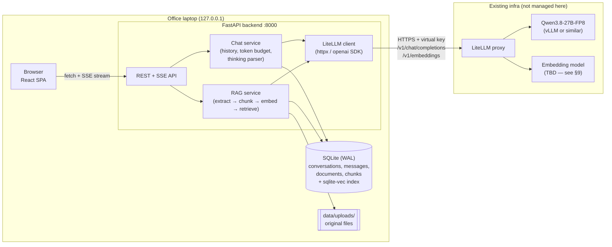
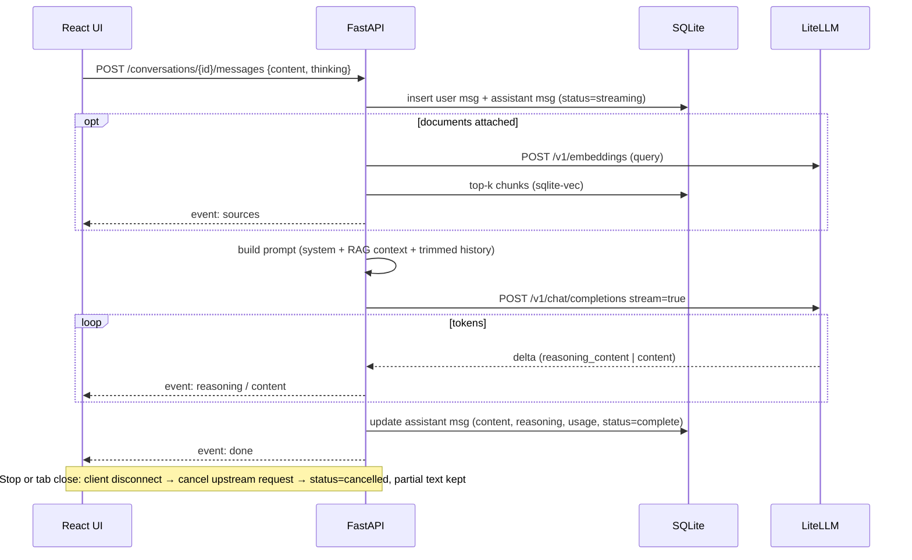

# Architecture — litellm-local-chatbot

> Status: **Draft for review** · Scope: single user, office laptop · Upstream: existing LiteLLM proxy serving `Qwen/Qwen3.8-27B-FP8`

## 1. Goals and non-goals

**Goals**
- A ChatGPT/Claude-style web chat for one user, running locally on the office laptop.
- Talk to the **already-hosted LiteLLM** proxy over its OpenAI-compatible API.
- Token streaming, markdown + syntax-highlighted code, stop generation.
- Saved conversations (sidebar, rename, delete).
- Show Qwen3 "thinking" in a collapsible block, with a toggle to turn thinking on or off.
- Chat with uploaded documents (RAG).
- Easy to run, easy to roll back: `main` is always runnable, and releases are tagged.

**Non-goals (for now)**
- Multi-user support, login, or SSO. The app binds to `127.0.0.1` only.
- Hosting or managing the model. LiteLLM and the inference server are upstream dependencies.
- Agents, tool calling, or web browsing.

## 2. High-level design



**Why there is a backend at all:** the browser could call LiteLLM directly, but then the API key sits in the browser, CORS has to be opened on LiteLLM, and there is nowhere to persist history or run RAG. The backend is a thin, trusted layer that owns the key, the database, and the prompt assembly.

**One process in production.** FastAPI serves the built React bundle (`frontend/dist`) as static files. On the laptop you run one command and open one URL. In development, Vite (`:5173`) proxies `/api` to uvicorn (`:8000`) for hot reload.

## 3. Key decisions (ADR summary)

| # | Decision | Chosen | Alternatives considered | Why |
|---|----------|--------|-------------------------|-----|
| 1 | Build vs adopt | Custom build | Open WebUI, LibreChat | Full control and a learning goal. Cost: we own streaming, history, and RAG edge cases. |
| 2 | Backend | Python 3.12 + FastAPI + uvicorn | Node or Next.js | Fits a DS/MLOps team; mature RAG and parsing libraries; async streaming is first-class. |
| 3 | Frontend | React + Vite + TypeScript | Next.js, Streamlit | SPA only; no SSR needed for a localhost app. Streamlit can't deliver a ChatGPT-grade UX. |
| 4 | Persistence | SQLite in WAL mode via SQLAlchemy 2.x + Alembic | Postgres | Single user means no server to run. The data is one file, so backup is a file copy. Alembic keeps a later move to Postgres possible. |
| 5 | Vector store | `sqlite-vec` in the same SQLite file, behind a `VectorStore` interface | Chroma, Qdrant, LanceDB, FAISS | One file, nothing extra to run. A personal corpus (≤ ~100k chunks) is well within brute-force or `sqlite-vec` range. Because of the interface, we can swap stores later without touching the rest of the code. |
| 6 | Browser ↔ backend streaming | SSE over `fetch()` with a `ReadableStream` | WebSockets | Responses only flow one way. SSE is plain HTTP, simpler to debug, and works through proxies. `fetch` is used instead of `EventSource` because the request needs a POST body. |
| 7 | LLM client | `openai` Python SDK pointed at LiteLLM `base_url` | Raw httpx, LangChain | LiteLLM is OpenAI-compatible. The SDK handles streaming, retries, and timeouts, and it keeps dependencies lean. No LangChain: it adds too much abstraction for what we need. |
| 8 | Packaging | Native (`uv` + a built frontend). Docker Compose is optional. | Docker-only | Corporate laptops often restrict Docker Desktop through licensing or admin rights. Native install has fewer moving parts. |
| 9 | Python tooling | `uv`, `ruff`, `pytest`; frontend: `pnpm`/`npm`, `eslint`, `vitest` | pip/poetry | Fast, reproducible lockfiles (`uv.lock`, `package-lock.json`). |

## 4. Repository layout

```
litellm-local-chatbot/
├── backend/
│   ├── app/
│   │   ├── main.py            # FastAPI app factory, static file mount
│   │   ├── config.py          # pydantic-settings, reads .env
│   │   ├── api/               # routers: health, models, conversations, chat, documents
│   │   ├── services/
│   │   │   ├── llm.py         # LiteLLM client wrapper (stream, cancel, retries)
│   │   │   ├── chat.py        # history assembly, token budget, thinking parser
│   │   │   └── titles.py      # auto-title generation
│   │   ├── rag/               # extract.py, chunk.py, embed.py, store.py, retrieve.py
│   │   └── db/                # models.py, session.py, migrations/ (Alembic)
│   ├── tests/                 # pytest; LiteLLM is mocked with respx
│   └── pyproject.toml / uv.lock
├── frontend/
│   ├── src/ (components/, hooks/useChatStream.ts, api/, pages/)
│   └── package.json / package-lock.json
├── scripts/                   # run.sh / run.ps1, backup_db, smoke_test
├── docs/ARCHITECTURE.md, docs/adr/, docs/RUNBOOK.md
├── .github/workflows/ci.yml   # lint + unit tests (no LiteLLM access in CI)
├── .env.example               # never commit .env
├── CHANGELOG.md
└── README.md
```

## 5. API contract (v1)

| Method | Path | Purpose |
|--------|------|---------|
| GET | `/api/health` | Liveness of the app, plus a cached LiteLLM reachability probe (`/v1/models`) |
| GET | `/api/models` | Proxy of LiteLLM `/v1/models` (filtered to allow-listed models) |
| GET / POST | `/api/conversations` | List and create conversations |
| GET / PATCH / DELETE | `/api/conversations/{id}` | Read with messages, rename, delete |
| POST | `/api/conversations/{id}/messages` | Send a user message; **the response is an SSE stream** |
| POST | `/api/conversations/{id}/regenerate` | Re-run the last assistant turn (SSE) |
| POST | `/api/messages/{id}/cancel` | Stop generation (also triggered when the client disconnects) |
| POST / GET / DELETE | `/api/documents` | Upload (multipart), list, delete |
| POST / DELETE | `/api/conversations/{id}/documents/{doc_id}` | Attach a document to a chat or detach it |

**SSE event types** (one JSON payload per event):

```
event: meta       {"message_id": "...", "model": "..."}
event: sources    [{"doc_id": "...", "filename": "...", "page": 3, "chunk_id": "..."}]
event: reasoning  {"delta": "..."}   # thinking tokens
event: content    {"delta": "..."}   # answer tokens
event: done       {"usage": {...}, "latency_ms": 1234, "finish_reason": "stop"}
event: error      {"code": "upstream_timeout", "message": "..."}
```

## 6. Data model (SQLite)

```mermaid
erDiagram
    conversations ||--o{ messages : has
    conversations ||--o{ conversation_documents : attaches
    documents ||--o{ conversation_documents : "attached to"
    documents ||--o{ chunks : "split into"
    conversations { text id PK  text title  text model  text system_prompt  bool thinking_enabled  datetime created_at  datetime updated_at }
    messages { text id PK  text conversation_id FK  text role  text content  text reasoning  text status  int prompt_tokens  int completion_tokens  int latency_ms  json sources  datetime created_at }
    documents { text id PK  text filename  text sha256  text mime  int size_bytes  text status  text error  datetime created_at }
    chunks { text id PK  text document_id FK  int ordinal  int page  text text  int token_count }
```



- `messages.status` takes `complete | streaming | cancelled | error`. A crash or disconnect in the middle of a stream never leaves an orphaned or invisible message. You see a partial answer marked *incomplete*.
- `messages.reasoning` is stored separately from `content`. It is shown in the UI but **not sent back** to the model in later turns, as Qwen recommends for multi-turn chat. This also saves context.
- Vectors live in a `sqlite-vec` virtual table `chunk_vectors(chunk_id, embedding float[N])`. Its dimension `N` is fixed by the embedding model. If you change embedding models, all documents must be re-embedded. This is recorded in a `meta` table so the app can detect the mismatch and refuse to mix dimensions.
- IDs are ULIDs, so they sort by time and are safe to show in URLs.

## 7. Core flows

### 7.1 Send message (streaming)



### 7.2 Qwen3 thinking handling

Qwen3 returns reasoning in one of two shapes, depending on how the upstream server is configured:
1. As a separate `reasoning_content` delta field, when vLLM runs with a reasoning parser and LiteLLM passes the field through.
2. Inline inside `content` as `<think> … </think>`.

The backend's `ThinkingParser` handles **both**. It is a small streaming state machine that works even when the `<think>` tag is split across chunks. It always emits clean `reasoning` and `content` events, so the UI never has to know which shape the server used.

**Toggle off:** send `extra_body={"chat_template_kwargs": {"enable_thinking": false}}`. If LiteLLM drops that parameter, fall back to Qwen's `/no_think` soft switch in the user turn. This must be checked against the actual deployment (§9).

### 7.3 Context window budgeting

`max_model_len` is upstream configuration and must be confirmed (§9). For each request:
`budget = max_model_len − max_output_tokens − safety margin`.
Request contents are added in priority order: system prompt → RAG context (capped, e.g. 30% of the budget) → newest history, walking back in time until the budget runs out. Tokens are counted with the Qwen tokenizer (`tokenizers` package, loaded offline), not `tiktoken`, because `tiktoken` miscounts Qwen tokens by roughly 10–20%.

### 7.4 RAG pipeline

- **Ingest** (runs as a background task after upload, and the UI shows a status):
  1. sha256 dedupe.
  2. Extract text: PDF with `pymupdf`, DOCX with `python-docx`, plus `txt` and `md`. Scanned PDFs without OCR fail clearly instead of being silently empty.
  3. Chunk at about 800 tokens with 100 tokens of overlap, keeping page numbers.
  4. Embed in batches.
  5. Store.
- **Scope:** documents are attached **per conversation**. This is more predictable than "search everything", and it is the way ChatGPT and Claude projects behave.
- **Small-document shortcut:** if all attached text fits within the RAG budget, include it verbatim and skip retrieval. This is both higher quality and simpler.
- **Retrieve:** embed the query, take the top-k (k=6) by cosine similarity, and prepend the chunks with `[source: filename p.N]` labels. The model is instructed to cite them, and the UI shows sources under the answer.
- **Limits:** a configurable maximum file size (default 25 MB) and allowed MIME types. Uploads are stored under `data/uploads/<sha256>`.

## 8. Cross-cutting concerns

**Security (single user, but still a corporate laptop)**
- Bind to `127.0.0.1` only, never `0.0.0.0`. CORS is off in production, since the frontend and backend share one origin.
- Only the backend holds the LiteLLM key, in `.env`, which is in `.gitignore`. Use a dedicated **LiteLLM virtual key** with a budget and rate limit, not the master key, so a runaway loop cannot burn shared capacity and the key can be revoked on its own.
- Rendered markdown is sanitized (`rehype-sanitize`), and raw HTML from the model is never injected. Model output is untrusted input, and this matters even more once documents enter the prompt (prompt injection through RAG).
- Corporate networks may need a custom CA bundle (`SSL_CERT_FILE`) and `NO_PROXY` set for the LiteLLM host. Both are config options, so nobody is tempted to turn TLS verification off.

**Reliability and failure modes**

| Failure | Behaviour |
|---------|-----------|
| LiteLLM unreachable or VPN down | Health badge turns red; send fails fast with a clear error; nothing is lost because the user message is already saved. |
| Upstream slow or GPU queue | Connect timeout 10 s, first-token timeout 120 s (configurable). No automatic retry on a stream that has already started; the user can regenerate. |
| Stream cut mid-answer | Partial answer is saved as `status=error` or `cancelled` and shown with a Retry button. |
| Context overflow (400 from upstream) | Caught and mapped to a friendly message; the budgeter should prevent it. |
| Embedding model changed | Dimension mismatch is detected at startup and documents are flagged "needs re-index". |
| DB corruption or a bad migration | `run` script takes an automatic SQLite backup **before** running Alembic migrations (keeps the last 5). |

**Observability (laptop scale)**
- Structured JSON logs to a rotating file in `data/logs/` with a request ID. Prompts are never logged at INFO level.
- Each message stores latency, time-to-first-token, and token usage. A later `/stats` page can chart these.
- LiteLLM's own spend logs remain the source of truth for usage.

**Configuration** (`.env`, validated at startup by pydantic-settings; the app fails fast with a clear message):
`LITELLM_BASE_URL`, `LITELLM_API_KEY`, `CHAT_MODEL`, `EMBEDDING_MODEL`, `MAX_CONTEXT_TOKENS`, `MAX_OUTPUT_TOKENS`, `DATA_DIR`, `SSL_CERT_FILE`, `REQUEST_TIMEOUT_S`, `MAX_UPLOAD_MB`.

## 9. Open questions (blocking design details)

1. **LiteLLM endpoint:** what is the base URL? Is it reachable from the laptop directly, or only over VPN or a corporate proxy? Does it use an internal CA certificate?
2. **Auth:** can you get a **virtual key** for this app, or is only the master key available?
3. **Embeddings:** is an embedding model exposed through LiteLLM (`/v1/embeddings`)? If not, the fallback is a local CPU model through `fastembed` (ONNX, e.g. `bge-small-en-v1.5`, about 130 MB, no GPU and no torch). The tradeoff is a model download on the laptop plus slower ingest.
4. **Model config:** what are the `max_model_len` and the inference server (vLLM? reasoning parser on?)? Does LiteLLM forward `chat_template_kwargs`? The smoke test below answers this.
5. **Laptop:** which OS, do you have admin rights, are Python 3.12 and Node 20+ installable, and is Docker allowed?
6. **Data sensitivity:** uploaded documents stay on the laptop, but their text is sent to the LiteLLM-hosted model. Is that acceptable for the documents you plan to use?

**Smoke test to run from the laptop** (answers questions 1, 3, and 4):

```bash
export LITELLM_BASE_URL=https://<your-litellm-host>   # no trailing /v1
export LITELLM_API_KEY=sk-...

# 1. Reachability + model list
curl -sS "$LITELLM_BASE_URL/v1/models" -H "Authorization: Bearer $LITELLM_API_KEY" | python -m json.tool

# 2. Thinking shape: look for "reasoning_content" vs "<think>" in content
curl -sS "$LITELLM_BASE_URL/v1/chat/completions" -H "Authorization: Bearer $LITELLM_API_KEY" \
  -H 'Content-Type: application/json' \
  -d '{"model":"Qwen/Qwen3.8-27B-FP8","messages":[{"role":"user","content":"What is 17*23?"}],"max_tokens":512}' | python -m json.tool

# 3. Thinking toggle passthrough: reasoning should be absent/empty
curl -sS "$LITELLM_BASE_URL/v1/chat/completions" -H "Authorization: Bearer $LITELLM_API_KEY" \
  -H 'Content-Type: application/json' \
  -d '{"model":"Qwen/Qwen3.8-27B-FP8","messages":[{"role":"user","content":"What is 17*23?"}],"max_tokens":256,"chat_template_kwargs":{"enable_thinking":false}}' | python -m json.tool

# 4. Embeddings available? (replace with a model name from step 1, if any)
curl -sS "$LITELLM_BASE_URL/v1/embeddings" -H "Authorization: Bearer $LITELLM_API_KEY" \
  -H 'Content-Type: application/json' -d '{"model":"<embedding-model>","input":"hello"}' | head -c 300
```

## 10. Delivery plan and GitHub Flow

**Branching:** `main` is always tested and runnable on the office laptop. Each change goes on a short-lived `feature/<name>` or `fix/<name>` branch, is merged through a PR once it works, and the branch is then deleted. A tag such as `vX.Y.Z` is added only to a commit that is **actually running on the laptop**.

**CI** (GitHub Actions, on every PR): `ruff`, `pytest` (LiteLLM mocked), `eslint`, `tsc`, `vitest`, and `npm run build`. CI cannot reach the internal LiteLLM, so a short manual smoke checklist on the laptop (`docs/RUNBOOK.md`) is the gate before tagging.

**Rollback:**
```bash
git fetch --tags && git checkout v0.1.0
scripts/run.sh   # restore the pre-upgrade DB backup if a migration ran
```

Rollback across a schema change needs the automatic pre-migration DB backup, because a newer schema is not guaranteed to work with older code. Every Alembic migration also implements `downgrade()`.

**Proposed milestones**

| Release | Branches (in order) | Contents |
|---------|---------------------|----------|
| v0.1.0 | `feature/backend-skeleton`, `feature/chat-streaming`, `feature/frontend-chat-ui`, `feature/conversation-history`, `feature/thinking-display` | Config + health check, streaming chat, markdown/code rendering, stop button, saved conversations, thinking block and toggle, run script, CI |
| v0.2.0 | `feature/rag-ingest`, `feature/rag-retrieval`, `feature/rag-ui` | Upload, per-chat documents, retrieval with citations, ingest status |
| v0.3.0 | (polish) | Regenerate/edit message, auto-titles, search history, export chat to Markdown, system prompt presets, `/stats` |

RAG is placed in **v0.2.0** rather than v0.1.0 on purpose. It depends on an unanswered question (embedding model availability), and it roughly doubles the surface area to test. Shipping chat first gives you a tagged, usable `main` sooner. The data model above already includes the document tables, so this ordering does not require rework later.
